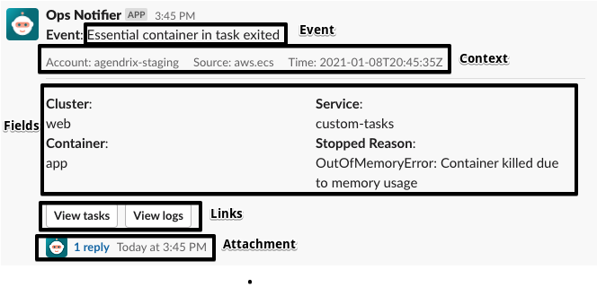

# EventBridge Slack notifier

_An AWS Lambda for sending EventBridge events to Slack channels_

 

## Description

The goal of this module is to send a Slack message to a specific channel when an EventBridge [rule](https://docs.aws.amazon.com/eventbridge/latest/userguide/create-eventbridge-rule.html) is triggered.

## Lambda payload

The lambda function payload is an object with the following type:

```ts
type Payload = {
  event: string;
  context: Array<Text> | undefined;
  fields: Array<Text> | undefined;
  body: Text | undefined;
  links: Array<Link> | undefined;
  attachment: object | undefined;
  key?: string;
  status?: string;
  time?: string;
};

type Link = {
  label: string;
  url: string;
};

type Text = {
  label: string;
  text: string;
};
```

`event`: String representing the event name. Required

`context`: Array containing event context information (Time, Event Source, etc). Optional

`fields`: Array containing event details. Field objects will be rendered side by side. Optional

`boyd`: Message body. Optional

`links`: Array containing Link objects. Each Link will be rendered has a button. Optional

`attachment`: If provided, this object will be attached as a JSON document in the message thread. Optional

`key`: Identity of the thing the events are about (an alarm, a resource). When provided, events sharing a key update a single Slack message instead of posting a new one. See [Updating a message in place](#updating-a-message-in-place). Optional

`status`: State carried by the event, used to pick the status emoji and to decide when the message is done. `OK` closes it; `ALARM` and `INSUFFICIENT_DATA` keep it open. Only used alongside `key`. Optional

`time`: When the event happened, as an ISO 8601 string. Defaults to the invocation time. Only used alongside `key`. Optional

## Updating a message in place

A state that flips back and forth normally costs two Slack messages and two notifications: one when it breaks, one when it recovers. Pass a `key` and the lambda posts the first message, then edits that same message for every later event sharing the key, until one of them carries `status: "OK"`.

The message then holds a timeline of the whole episode:

```
🔴 ALARM - Api - DB - Master - DiskQueueDepth
Account: my-account · Source: aws.cloudwatch
────────
🔴 23:36:38 ALARM — Threshold Crossed: 5 out of the last 5 datapoints...

                            ↓ same message, 7 minutes later

🟢 RESOLVED - Api - DB - Master - DiskQueueDepth · 7 min
Account: my-account · Source: aws.cloudwatch
────────
🔴 23:36:38 ALARM — Threshold Crossed: 5 out of the last 5 datapoints...
🟢 23:43:38 OK — Threshold Crossed: 5 datapoints were not greater than...
```

Editing a message raises no Slack notification, which is the point: only a new episode notifies. Once an episode is closed, the next event carrying the same key starts a new message.

No state is stored outside of Slack. The episode travels in the [message metadata](https://api.slack.com/metadata) and is read back with `conversations.history`, which imposes two requirements:

- `slack_config.channel` must be a **channel ID** (`C0ABC123DEF`), not a name. The lambda refuses to run otherwise rather than silently posting duplicates.
- the bot must be a **member of the channel** and hold the `channels:history` scope (`groups:history` for a private channel). Posting alone does not require membership, reading the history does.

Only the last 100 messages of the channel are searched, so an episode that outlives 100 later messages in the same channel ends with its resolution posted as a new message.

## Example:



## How to use with Terraform

Add the module to your [Terraform](https://www.terraform.io/) project:

```HCL
module "eventbridge_slack_notifier" {
  source = "github.com/agendrix/eventbridge-slack-notifier.git//terraform?ref=v0.2.0"

  slack_config = {
    channel      = "#channel"
    access_token = "access_token"
  }

  event_pattern = jsonencode({
    source      = ["aws.cloudwatch"]
    detail-type = ["CloudWatch Alarm State Change"]
  })


  input_transformer = {
    input_paths = {
      source                     = "$.source"
      time                       = "$.time"
      alarm                      = "$.detail.alarmName"
      previous_state_value       = "$.detail.previousState.value"
      current_state_value        = "$.detail.state.value"
      current_state_value_reason = "$.detail.state.reason"
    }

    input_template = <<EOF
    {
      "event": <alarm>,
      "context": [
        {
          "label": "Source",
          "text": <source>
        },
        {
          "label": "Time",
          "text": <time>
        }
      ],
      "fields": [
        {
          "label": "Previous Alarm State",
          "text": <previous_state_value>
        },
        {
          "label": "Current Alarm State",
          "text": <current_state_value>
        }
      ],
      "body": {
        "label": "Details",
        "text": <current_state_value_reason>
      },
      "links": [
        {
          "label": "View alarms",
          "url": "https://ca-central-1.console.aws.amazon.com/cloudwatch/home?region=ca-central-1#alarmsV2:"
        }
      ]
    }
    EOF
  }
}
```

### Resources:

[How to create a rule pattern](https://docs.aws.amazon.com/eventbridge/latest/userguide/eventbridge-and-event-patterns.html)

[Input transformer](https://docs.aws.amazon.com/eventbridge/latest/userguide/transform-input.html)

[Input transformer Terraform](https://registry.terraform.io/providers/hashicorp/aws/latest/docs/resources/cloudwatch_event_target#input_transformer)

[Common input transformer issues](https://docs.aws.amazon.com/eventbridge/latest/userguide/transform-input.html#transform-input-issues)
